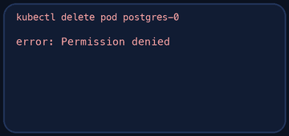
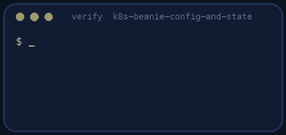

<p align="center"></p>

| | |
|-|-|
| **Time** | 105-120 min |
| **Cost** | free on a local cluster |
| **You need** | Docker, kubectl, git, curl, Python 3 and a local Kubernetes cluster (kind, OrbStack or Docker Desktop) running |

## How this lab works

1. **Fork** this repository to your own GitHub account (button at the top right).
2. Clone **your fork** in your Ubuntu environment (WSL on Windows, your OrbStack machine on Mac).
3. Read the lab below (the same text is in [`LAB.md`](LAB.md)) and follow the mission.
4. Answer the questions in [`SUBMISSION.md`](SUBMISSION.md). Where a question asks for output, paste it in a code block. No screenshots needed.
5. Commit and push. Open the **Actions** tab of your fork (click *I understand my workflows, go ahead and enable them* the first time). The **Lab check** shows what is still missing.
6. When the check is green, **submit the URL of your fork** in the course platform.

> [!NOTE]
> The check only looks at your answers and any files the lab asks you to commit. Your instructor reads your work and may ask you to explain any line.

<p align="center"></p>

## 🎬 The situation

<p align="center"></p>

```text
BUG REPORT #212 - "My order disappeared"                  status: reproducible
Reporter   : a customer, Saturday
Steps      : place an order, refresh the page
Expected   : the order is in the list
Actual     : the list is empty. A colleague looking at the same time saw three orders.
Later      : a pod was replaced during a deployment. Every order since the morning vanished.
Dev reply  : "Without DATABASE_URL, orders live in the process. Two replicas of
              orders then show different orders."
```

Each pod keeps its orders in its own memory, and a pod's memory dies with the pod. Today you give Beanie a real database, the way a cluster expects: the settings in a **ConfigMap**, the password in a **Secret** that never touches git, the database as a **StatefulSet** with a **PersistentVolumeClaim**. The proof is brutal: an order must outlive the deletion of the pod that stored it.

> [!IMPORTANT]
> **Your mission**
> - See the bug first: two `orders` replicas, two different histories
> - Move shared settings into a ConfigMap
> - Create a database password as a Secret without writing it in any file
> - Run PostgreSQL as a StatefulSet with a persistent volume
> - Point `orders` at it, then delete the database pod and every `orders` pod, and still find every order
> - Tear it all down and prove it

**Time:** 105-120 min | **Cost:** free on a local cluster | **You need:** Docker, `kubectl`, git, curl, Python 3 and a local Kubernetes cluster running (kind, OrbStack or Docker Desktop with Kubernetes enabled). Check with `kubectl get nodes`.

<p align="center"></p>

## Part 0 - Get Beanie running

Fork this repository, clone your fork, and run:

```bash
./setup.sh
kubectl apply -f k8s/base/
kubectl get pods -n beanie -w
```

`k8s/base/` is a working Beanie (the result of the previous lab). `orders` runs two replicas and has no database. Read `k8s/TODO.md`.

<p align="center"></p>

## Part 1 - See the bug

<p align="center"></p>

```bash
kubectl port-forward -n beanie svc/gateway 8000:8000
```

In another terminal, place five orders, then list them several times:

```bash
for i in 1 2 3 4 5; do
  curl -s -o /dev/null -X POST localhost:8000/api/orders -H 'Content-Type: application/json' \
    -d "{\"customer\": \"Customer $i\", \"items\": [{\"item_id\": \"flat-white\", \"quantity\": 1}]}"
done
for i in 1 2 3 4 5 6; do curl -s localhost:8000/api/orders | python3 -c "import sys,json; print(len(json.load(sys.stdin)), 'orders')"; done
```

The count jumps around. The Service balances requests over the two pods, and each pod has seen only some of the orders. Now delete both `orders` pods (`kubectl delete pods -n beanie -l app=orders`) and list again.

> [!NOTE]
> **Think** Which part of the Kubernetes model makes it fine to delete pods at any time, and which part of your application is not compatible with it? Say it in one sentence for question 1.

<p align="center"></p>

## Part 2 - Settings in a ConfigMap

Write `k8s/config.yaml`: a ConfigMap `beanie-config` in the namespace `beanie` holding `LOG_LEVEL`, `LOG_FORMAT`, `DOWNSTREAM_TIMEOUT` and `MAX_ITEMS_PER_ORDER` (see `.env.example` in `beanie/` for the meaning and sensible values). Then make `orders` read them with `envFrom` (TODO A in `k8s/base/orders.yaml`).

> [!NOTE]
> **Think** Why is the **database URL** not in the ConfigMap? What is the difference between a value that is merely "configuration" and one that is a "secret"?

<p align="center"></p>

## Part 3 - The password, as a Secret that is not in git

Create the Secret from the command line so that the password exists in the cluster and nowhere in your repository:

```bash
kubectl create secret generic db-credentials -n beanie \
  --from-literal=POSTGRES_PASSWORD="$(openssl rand -hex 16)"
```

(Make the namespace first if it does not exist. The checker wants a password of 12 characters or more that is not `postgres` or `password`. Why `-hex` and not `-base64`? The password goes inside a URL, and base64 can produce `/`, `+` and `=`, which a URL parser reads as syntax. A password that breaks the connection string is a classic 2 a.m. outage.)

Look at what is stored:

```bash
kubectl get secret db-credentials -n beanie -o yaml
kubectl get secret db-credentials -n beanie -o jsonpath='{.data.POSTGRES_PASSWORD}' | base64 -d; echo
```

> [!NOTE]
> **Think** Anyone who can read the Secret can decode it in one command. So what does a Secret protect you from, and what does it not? Name one way a real cluster does better than this (encryption at rest, an external secret store, sealed secrets).

<p align="center"></p>

## Part 4 - PostgreSQL that remembers

Write `k8s/postgres.yaml` with two objects:

1. A **headless Service** `postgres` (`clusterIP: None`) on port 5432: it gives the pod a stable DNS name and does not load-balance.
2. A **StatefulSet** `postgres` (image `postgres:16`, one replica, `serviceName: postgres`) with the environment `POSTGRES_DB=beanie`, `POSTGRES_USER=beanie`, `POSTGRES_PASSWORD` **from the Secret** (`secretKeyRef`), `PGDATA=/var/lib/postgresql/data/pgdata` (a subdirectory: a fresh volume often contains `lost+found`, which stops PostgreSQL from initialising), a readiness probe using `pg_isready`, requests and a memory limit, and a **`volumeClaimTemplates`** entry of 1Gi mounted at `/var/lib/postgresql/data`.

```bash
kubectl apply -f k8s/postgres.yaml
kubectl get pods,pvc,pv -n beanie
```

The PVC `data-postgres-0` appears and becomes `Bound`. If it stays `Pending`, your cluster has no default StorageClass: `kubectl get storageclass`.

> [!NOTE]
> **Predict** If you delete the pod `postgres-0`, what will the new pod be called, and which volume will it get? And if you delete the **StatefulSet** itself? The PVC?

<p align="center"></p>

## Part 5 - Connect orders to it

TODO B in `k8s/base/orders.yaml`: give `orders` the password from the Secret as an environment variable and build `DATABASE_URL` from it with `$(VAR)` expansion:

```text
postgresql://beanie:<password>@postgres:5432/beanie
```

The Secret is the only place the password lives; the URL in the manifest has the *variable*, not the value. Apply and watch the rollout. Place orders and list them again:

```bash
kubectl apply -f k8s/base/orders.yaml
kubectl rollout status -n beanie deployment/orders
```

Now every list shows the same orders, whichever pod answers.

<p align="center"></p>

## Part 6 - Delete everything that is allowed to die

```bash
kubectl delete pod -n beanie postgres-0
kubectl get pods -n beanie -w          # a new postgres-0
curl -s localhost:8000/api/orders      # all orders are still there
kubectl delete pods -n beanie -l app=orders
```

Change one value in the ConfigMap (for example `LOG_LEVEL` to `debug`), apply it and look at the logs of a running `orders` pod. Did anything change? Now `kubectl rollout restart -n beanie deployment/orders`.

> [!NOTE]
> **Think** A ConfigMap used with `envFrom` is read when the container starts. How would you make a ConfigMap change roll out automatically (hint: a checksum annotation in the pod template, or a tool like Helm or Reloader)?

<p align="center"></p>

## Part 7 - Prove it

<p align="center"></p>

```bash
./verify.sh
```

It checks that no secret is in your files, reads the ConfigMap, Secret, StatefulSet and PVC from the cluster, places orders, checks that every `orders` replica shows the same data, and then deletes the database pod and every `orders` pod. Fix what is red and run it again until it ends with **ALL CHECKS PASSED**.

> [!TIP]
> **Stuck?** `orders` in `CrashLoopBackOff`: the database is not ready or the URL is wrong (`kubectl logs`); remember `orders` needs PostgreSQL at startup. PVC `Pending`: no default StorageClass. `initdb: directory ... exists but is not empty`: you forgot `PGDATA`. `PoolTimeout` or `couldn't get a connection` right after you set the Secret: look at the password for `/`, `@` or `:`, which break the URL. `password authentication failed`: the Secret was created *after* PostgreSQL first initialised its data directory with another password; delete the StatefulSet **and** the PVC and start again. `$(POSTGRES_PASSWORD)` appears literally in the URL: the variable must be defined *before* `DATABASE_URL` in the `env` list.

<p align="center"></p>

## Level up (optional)

- Add a `PodDisruptionBudget` and a `topologySpreadConstraints` for `orders`.
- Back up the database: write a `CronJob` that runs `pg_dump` into a second volume. How do you know the backup restores?
- Replace the Secret with the Secrets Store CSI driver (AWS Secrets Manager or Azure Key Vault) or `sealed-secrets`. What changes in your repository?

<!-- teardown:start (generated by labs.py, do not edit) -->
## Tear down (mandatory)

<p align="center"></p>

Resources left behind cost money, keep doors open and pollute the next lab. Removing what you created is part of the job, so it is part of the submission: **you must prove it is gone**.

Do this **last**, after you have pasted your `verify` output into `SUBMISSION.md` (once you tear down, the lab can no longer be verified).

1. Run `./teardown.sh`. It deletes the `beanie` namespace, including the volume claim and its data, and the cloned Beanie source.

Then run the proof:

```bash
./verify-teardown.sh
```

It prints a list of checks and must end with **TEARDOWN VERIFIED**. If it reports leftovers, remove them and run it again. Paste the full output in your submission.
<!-- teardown:end -->

<!-- submission:start (generated by labs.py, do not edit) -->
## 📬 Submission

Answer the questions in `SUBMISSION.md` in **your fork** (paste output in code blocks where asked), push, then submit the **URL of your fork**.

**Files to commit**

- `k8s/` with your manifests (ConfigMap, Secret created from the command line, PostgreSQL StatefulSet with a PVC, the updated Deployments)
- `notes.md` with your commands and what you saw (optional)

**Questions to answer**

1. Before the fix: paste two `GET /api/orders` answers taken from two different orders pods. Why do they differ, and why does the README say a database is the lesson?
2. Paste your ConfigMap and say which values you moved there. Why is the database URL not in it?
3. The database password: how did you create the Secret without writing the password in a file you commit? Is a Secret encrypted? Say what base64 does and does not do, and name one way to do better in a real cluster.
4. Paste `kubectl get pvc,pv,statefulset -n beanie`. Delete the PostgreSQL pod, wait for it to come back, and paste an order placed before the deletion. What object kept the data and what would happen to it if you deleted the StatefulSet? The PVC?
5. Why did you use a StatefulSet and not a Deployment for PostgreSQL? Name two guarantees it gives that a Deployment does not.
6. Change a value in the ConfigMap. Do the running pods see it? What did you have to do and how would you automate it?
7. Paste the output of `./verify.sh`. It must end with **ALL CHECKS PASSED**.
8. **Tear down.** Paste the output of `./verify-teardown.sh`. It must end with **TEARDOWN VERIFIED**.
<!-- submission:end -->
